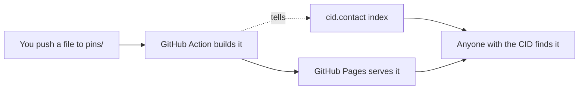
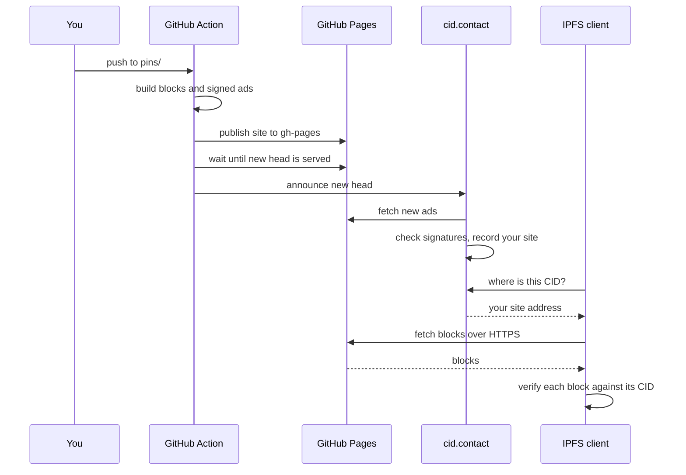

# gitpin

**A hands-on first step into IPFS: publish files straight from a GitHub repo, with no IPFS node to run.**

On the web, a link says *where* a file is. On [IPFS](https://ipfs.tech), a link says *what* the file is. Every file gets a **CID** (content identifier), a fingerprint computed from its exact bytes, such as `bafkreidq7f...`. Anyone who fetches a CID can check that the bytes they got are the ones it names, and the same CID works whichever server sends them. That makes a CID a good way to cite a dataset, ship a release, or point at an NFT or website asset that must never change under you.

gitpin gets your files a CID without running any IPFS software. Drop a file into your repo's `pins/` folder and push. A GitHub Action publishes it, and the run summary shows its CID with links you can share.



> **A starting point, not a safe home.** gitpin serves your files from one place: your GitHub Pages site. If GitHub has an outage, the repo goes away, or the content is taken down, the CID stops resolving unless someone else holds a copy. IPFS is resilient and censorship resistant only when several independent nodes hold the content, so for anything that matters, also [pin it elsewhere](#pin-it-elsewhere-too).

**Jump to:** [First example](#example-your-first-cid) | [More examples](#more-examples) | [Pin elsewhere](#pin-it-elsewhere-too) | [Get started](#get-started) | [Why](#why-gitpin) | [How it works](#how-it-works) | [Configuration](#configuration) | [Custom domain](#use-a-custom-domain) | [Command line](#command-line) | [Limits](#limits) | [Troubleshooting](#troubleshooting) | [Contributing](#contributing) | [License](#license)

---

## Example: your first CID

The template repo ships one file:

```
pins/hello.txt    Hello from my first IPFS pin!
```

After setup (below, about five minutes), every push that changes `pins/` runs the action. The run summary lists what was published:

| Name | CID | Links |
| --- | --- | --- |
| hello.txt | `bafkreidq7firpceoqbimkvlqp54nguhgufy7ynnsfpl3ya2as7lmwn2tua` | open, ipfs.io, dweb.link, index |

That CID names those 30 bytes, and it is the same on every machine in the world. Anyone can fetch it, and their client checks the bytes against the CID:

```sh
# in a browser
https://inbrowser.link/ipfs/bafkreidq7firpceoqbimkvlqp54nguhgufy7ynnsfpl3ya2as7lmwn2tua

# with Kubo, the IPFS command-line node
ipfs cat bafkreidq7firpceoqbimkvlqp54nguhgufy7ynnsfpl3ya2as7lmwn2tua
Hello from my first IPFS pin!
```

Your site, `https://<your-username>.github.io`, shows the same list with the same links.

---

## More examples

**Publish a dataset folder.** Every top-level file or folder in `pins/` is one pin with its own CID. A folder gets one directory CID, and each file inside is reachable by path:

```
pins/
  survey-2026/
    responses.csv
    codebook.pdf
```

```sh
ipfs cat <cid>/responses.csv
https://inbrowser.link/ipfs/<cid>/codebook.pdf
```

Cite `ipfs://<cid>` in your paper. A reader who gets bytes for that CID from anywhere knows they are the bytes you published.

**Fetch from a script.** Small files (up to 256 KiB) are one raw block, served as-is by your own site, so you can check them yourself:

```sh
curl -s https://<your-username>.github.io/ipfs/<cid> -o hello.txt
```

For anything bigger, or to have the check done for you, use Kubo (`ipfs cat <cid>`; version 0.43 or newer was tested) or an IPFS library such as Helia. The public gateways ipfs.io and dweb.link work in a web browser only. They answer scripts with an error.

**Change or remove a file.**

- Edit a file in `pins/` and push: it gets a new CID, and the old CID stops resolving from your site.
- Delete it from `pins/` and push: its blocks are removed from the site and cid.contact is told to drop the record.

---

## Pin it elsewhere too

Your Pages site is the only server holding the files, so a GitHub outage, a deleted repo or a takedown makes them unreachable. Every other node that pins the same CID is another independent source, and the links you shared keep working through any of them. The more copies, run by different people in different places, the harder your files are to lose or censor.

```sh
ipfs pin add <cid>     # on your own Kubo node, or a friend's
```

Or add the CID to an IPFS pinning service. gitpin gets your files onto IPFS; copies elsewhere are what keep them there.

---

## Get started

You need a GitHub account and a terminal with `ssh-keygen` (built into macOS, Linux and Windows 10 or newer).

1. **Create the repo.** On [github.com/ipni/gitpin-template](https://github.com/ipni/gitpin-template) click **Use this template** > **Create a new repository**. Name it exactly `<your-username>.github.io` and make it **Public** (free accounts need a public repo for Pages).
2. **Make a key.** In a terminal, run:

   ```sh
   ssh-keygen -t ed25519 -C gitpin -f gitpin-key
   ```

   When it asks for a passphrase, press **Enter** twice (gitpin needs a key without one). This makes two files in the current folder: `gitpin-key` (the private key) and `gitpin-key.pub`. Make a new key just for gitpin, never reuse your own SSH login key: any workflow in the repo can read the secret.
3. **Add the secret.** Open `gitpin-key` in a text editor and copy all of it, including the `BEGIN` and `END` lines. In the new repo: **Settings** > **Secrets and variables** > **Actions** > **New repository secret**. Name it `GITPIN_KEY`, paste, click **Add secret**. Then delete both key files; the secret is the only copy you need.
4. **Create the `gh-pages` branch.** On the repo's main page, open the branch menu (it shows `main`), type `gh-pages`, and click the option to create the branch from `main`. gitpin replaces its contents on the first run.
5. **Point Pages at it.** **Settings** > **Pages** > **Build and deployment**: Source **Deploy from a branch**, Branch `gh-pages`, folder `/ (root)`, **Save**. GitHub usually has Pages on already for a repo named `<your-username>.github.io`, serving `main`. You only change the branch.
6. **Run the workflow.** **Actions** tab > **gitpin** workflow > **Run workflow**. When it is green, the run summary lists each pin with its CID and links. The first run takes a few minutes longer while Pages deploys.

The [template README](https://github.com/ipni/gitpin-template#readme) walks through the same steps for people new to GitHub Actions. Already have a `<your-username>.github.io` repo? If you already use it for a website, adding gitpin to it would replace that website, so [use a custom domain](#use-a-custom-domain) or create the repo under a GitHub organization you own.

---

## Why gitpin

| Question | Answer |
| --- | --- |
| **Why a CID, not a URL?** | A URL names a place, and whoever controls the place decides what you get. A CID names the content: it is a hash, so a client can tell if it got anything else. The same CID works whether the bytes come from your site, a pinning service, a colleague's laptop or a public gateway. That suits citations, releases and on-chain references. |
| **Why is IPFS publishing usually hard to start?** | You need a machine that stays online, runs an IPFS node, and tells the network what it holds, or an account with a pinning service. gitpin lets you try IPFS first with the GitHub account you already have. |
| **What does gitpin do instead?** | IPFS clients can fetch content over plain HTTPS from any server that follows the [trustless gateway](https://specs.ipfs.tech/http-gateways/trustless-gateway/) format. They find those servers through [IPNI](https://docs.ipfs.tech/concepts/ipni/) indexers such as cid.contact. Both only need static files. So the action writes your content and its index records as static files, GitHub Pages serves them, and cid.contact reads them from your site. Nothing of ours stores your bytes. |
| **What does "pin" mean here?** | Not copies on many machines. A pin is a file or folder in `pins/` that gitpin publishes. Your files are online exactly while your Pages site is. The CID is the lasting part: add it to a pinning service or your own node any time, and every existing link keeps working. |
| **Is this free IPFS hosting?** | No. It is an easy way to start. GitHub hosts the bytes on its own terms (Pages is meant for websites and has size and traffic limits), and everything depends on that one company. What makes content on IPFS hard to lose or censor is several independent copies, which means pinning it on other nodes or with a pinning service as well. |

---

## How it works



**On each run the action:**

1. Builds every file and folder in `pins/` into UnixFS blocks (CIDv1, raw leaves, 256 KiB chunks) and writes each block to `ipfs/<cid>` on the site.
2. Writes IPNI advertisements to `ipni/v1/ad/`: one per new pin, a removal for each deleted pin, each signed with your key and linked to the previous one. It then writes a signed pointer to the newest one at `ipni/v1/ad/head`.
3. Pushes the whole site to the `gh-pages` branch as a single commit with no history, so removed blocks do not pile up.
4. Waits until GitHub Pages serves the new head, then announces it to `https://cid.contact/announce`.
5. cid.contact fetches the new advertisements from your site, checks the signatures, and records that your site serves those CIDs over the trustless gateway protocol.
6. Optionally waits until cid.contact lists every pin.

A client asks cid.contact (directly, or through delegated routing at delegated-ipfs.dev) where a CID is, gets your site's address, fetches the blocks over HTTPS and checks each one against its CID.

<details>
<summary>The published site, file by file</summary>

```
.nojekyll          turns off Jekyll
index.html         the list of pins and links
gitpin.json        what is published (state for the next run)
ipfs/bafkqaaa      empty probe file IPFS clients request first
ipfs/<cid>         one file per block
ipni/v1/ad/head    signed pointer to the newest advertisement
ipni/v1/ad/<cid>   advertisements and entry lists
```

</details>

---

## Configuration

The template's workflow, `.github/workflows/gitpin.yml`, is all you need.

<details>
<summary>Full workflow YAML</summary>

```yaml
name: gitpin
on:
  push:
    branches: [main]
    paths: ['pins/**']
  workflow_dispatch:
permissions:
  contents: write
  pages: read
concurrency:
  group: gitpin
  cancel-in-progress: false
jobs:
  pin:
    runs-on: ubuntu-latest
    steps:
      - uses: actions/checkout@v4
      - uses: ipni/gitpin@v1
        with:
          key: ${{ secrets.GITPIN_KEY }}
```

</details>

**`pages: read`** lets the action stop at once, with the fix, when Pages points at the wrong branch. Workflows made before it was added still work; without it a wrong Pages setting shows up as a 10-minute wait that ends in "is not serving the new head yet".

**Keep the default credentials.** Leave `actions/checkout` as it is: `persist-credentials: false` breaks the push to `gh-pages`.

**Keep the `concurrency` group.** It is required, not optional: two overlapping runs each force-push their own snapshot of `gh-pages`, and the losing run's published files are silently dropped.

**Inputs of `ipni/gitpin@v1`:**

| Input | Default | Description |
| --- | --- | --- |
| `key` | required | The signing key: `${{ secrets.GITPIN_KEY }}`. |
| `content` | `pins` | Folder to publish, relative to the repo root. |
| `branch` | `gh-pages` | Branch the site is pushed to. |
| `base-url` | `https://<owner>.github.io` | Where the site is served. Set `https://your.domain` for a custom domain. |
| `indexer` | `https://cid.contact` | IPNI indexer to announce to. |
| `wait-indexed` | `true` | Wait until the indexer lists every pin. On timeout the run ends with a warning, not a failure. |

**Outputs:** `head` (CID of the newest advertisement) and `peer-id` (the peer ID of your key, which identifies your site on cid.contact).

---

## Use a custom domain

With a custom domain the repo can have any name, and an account that already uses `<your-username>.github.io` for something else can still use gitpin. The site must be at the domain root, not under a path.

1. **Point the domain at GitHub Pages** with DNS (see GitHub's custom domain docs).
2. **Set the base URL.** Add `base-url: https://your.domain` under `with:` in the workflow.
3. **Create the `gh-pages` branch** from the branch menu, as in step 4 of [Get started](#get-started).
4. **Set up Pages.** In **Settings** > **Pages**, set the source to branch `gh-pages`, folder `/ (root)`, and enter the domain. GitHub writes a `CNAME` file to `gh-pages`, which gitpin keeps.
5. **Wait for HTTPS.** GitHub issues the certificate only after you enter the domain, which can take a while. Wait until `https://your.domain` loads with a valid certificate (the **Enforce HTTPS** box becomes available). Until then the run fails with "is not serving the new head yet (last status no response)".
6. **Run the workflow.**

---

## Command line

The action runs a small Go program you can also run yourself, to test or to host the site directory somewhere else. It builds the site locally. It does not push or serve anything.

```sh
go install github.com/ipni/gitpin/cmd/gitpin@latest
```

<details>
<summary>Commands, output and exit codes</summary>

```sh
gitpin keygen                                             # prints GITPIN_KEY=... and PEER_ID=...
GITPIN_KEY=... gitpin publish --content pins --site site --base-url https://you.example
gitpin announce --site site --base-url https://you.example [--indexer URL]
gitpin wait-indexed --site site [--indexer URL] [--timeout 15m]
```

`gitpin keygen` prints a `GITPIN_KEY=...` line; the part after the `=` is also a valid value for the secret.

`publish` prints one JSON line: `{"changed":true,"head":"...","peer_id":"...","roots":[{"name":"hello.txt","cid":"..."}]}`.

| Exit code | Meaning |
| --- | --- |
| 0 | ok |
| 1 | error |
| 2 | `wait-indexed` timed out (the files are published; the index is slow) |
| 64 | usage |

</details>

---

## Limits

| Limit | What to know |
| --- | --- |
| **Public** | Anyone can fetch your pins, and the CIDs and your peer ID are listed on cid.contact. Do not publish secrets or personal data. |
| **One host** | Your files are online while your GitHub Pages site is. A GitHub outage, a deleted repo or a takedown makes them unreachable, except from nodes that hold a copy. On its own this is neither durable storage nor censorship resistant; [pin it elsewhere](#pin-it-elsewhere-too) for that. |
| **Size** | At most 500 MiB and 50,000 blocks of content per repo. GitHub Pages limits a site to 1 GB and about 100 GB of traffic a month, and its terms are for websites, not bulk file hosting. |
| **Root sites only** | Project sites (`<username>.github.io/<repo>`) are not supported: IPFS clients need the site at a domain root. |
| **Files only** | Names starting with `.` are skipped. Symlinks fail the run with `unsupported file type: <path>`. |
| **The content folder** | Deleting it, or naming the `content` input wrong, unpublishes everything: the next run removes every pin. |
| **Indexing takes time** | A new pin usually shows up on cid.contact within minutes, sometimes up to an hour. Until then clients may not find it. |
| **Your key** | It signs your advertisements. Keep it only in the `GITPIN_KEY` secret. Make one with the `ssh-keygen` command in step 2 of [Get started](#get-started). |

---

## Troubleshooting

<details>
<summary>"... is not serving the new head yet"</summary>

Pages is off, its source is not the `gh-pages` branch, the repo is private, the repo is not named `<owner>.github.io` and no `base-url` is set, or a custom domain is not pointing at Pages yet. Fix the setting and re-run the workflow.

</details>

<details>
<summary>"GitHub Pages serves ... but gitpin pushed to ..."</summary>

Pages is serving another branch or folder, or deploys from GitHub Actions. Set it as the message says (**Settings** > **Pages**: **Deploy from a branch**, `gh-pages`, `/ (root)`) and re-run the workflow.

</details>

<details>
<summary>"... redirects to ..."</summary>

The site redirects, usually because a custom domain is set while `base-url` is still the default `https://<owner>.github.io`, or the domain was given as the apex while Pages serves `www` (or the other way round). Set `base-url` to the exact origin that serves the site.

</details>

<details>
<summary>"The GITPIN_KEY secret is not set"</summary>

Add the secret (step 3 of [Get started](#get-started)).

</details>

<details>
<summary>"needs a repo named `<owner>.github.io`"</summary>

Rename the repo, or [use a custom domain](#use-a-custom-domain).

</details>

<details>
<summary>"GITPIN_KEY belongs to ... but gitpin.json was written by ..."</summary>

The key changed since the last run. If that was on purpose (for example after a leak), make a new key with the command in step 2 of [Get started](#get-started), replace the secret, then delete `gitpin.json` and the `ipni/` folder from the `gh-pages` branch, and re-run. `ipfs/` can stay. The new key has a new peer ID; records under the old one expire on cid.contact over time.

</details>

<details>
<summary>"GITPIN_KEY is not an Ed25519 key"</summary>

The secret holds something else, often the `gitpin-key.pub` file or a cut-off paste. Paste the whole private key file again, or make a new key with the command in step 2 of [Get started](#get-started).

</details>

<details>
<summary>"GITPIN_KEY has a passphrase"</summary>

Your key was made with a passphrase. Make a new key (step 2 of [Get started](#get-started)), press **Enter** at the passphrase prompt, and replace the secret.

</details>

<details>
<summary>Yellow "cid.contact has not indexed every pin yet" warning</summary>

Your files are published. Wait a few minutes and re-run the workflow, or just check the index link later.

</details>

---

## Contributing

The repo holds the Go program (`cmd/gitpin`, `internal/`), the composite action (`action.yml`) and the template repo's files (`template/`).

```sh
go test ./...                              # Go packages
```

Issues and pull requests are welcome at [github.com/ipni/gitpin](https://github.com/ipni/gitpin).

---

## License

Dual-licensed under [Apache-2.0](https://www.apache.org/licenses/LICENSE-2.0) or [MIT](https://opensource.org/licenses/MIT), at your option, like other IPNI and IPFS projects. See [LICENSE.md](LICENSE.md).
